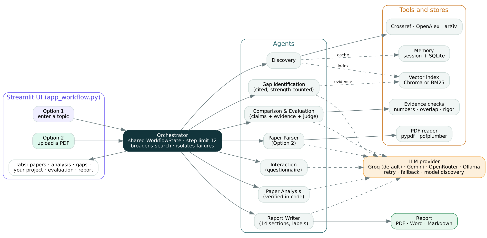

# ResearchPilot

**An autonomous multi-agent AI system for research discovery, analysis, research-gap identification and report generation.**

ResearchPilot helps a student or researcher answer: *what has been done on my topic, what is still missing, and where does my work (or this paper) fit?* It finds papers, extracts what they did, identifies gaps, compares your project or an uploaded paper with the literature, and writes an evidence-labelled report (PDF, Word, Markdown).



## Two ways to use it

| | Option 1: Start New Research Analysis | Option 2: Upload Research Paper |
|---|---|---|
| Input | A topic or project idea | A text-based PDF |
| Flow | Discover papers → analyse → find gaps → answer questions about your project → compare → report | Read PDF → extract claims (verified against the paper's text) → find related work → analyse → gaps → compare → report |

## What makes it trustworthy

Every statement in a report carries one of three labels: **Verified from papers** (computed by code from abstracts), **User-provided / From uploaded paper** (not independently verified), or **AI-generated** (a hypothesis, not a finding). Key safeguards (all tested):

- Papers without an abstract are never sent to the LLM.
- Named items and numbers the LLM extracts must appear in the source text, or they are dropped.
- Research gaps must cite real analysed papers; evidence strength is counted by code, not claimed by the model.
- Whether a claimed improvement is supported is decided from the user's own numbers, by code.
- AI narrative paragraphs are rejected if they cite non-existent references, invent numbers or claim novelty.
- Text from PDFs, APIs and the LLM is treated as untrusted: prompt delimiters cannot be broken, and nothing renders as an image, link or HTML in the app.
- Step limit of 12 per workflow, bounded retries, readable errors, API keys redacted from logs.

## Requirements

- Python 3.10 or newer
- A free LLM key. Default: **Groq** (<https://console.groq.com/keys>, no card). Gemini, OpenRouter, Ollama or any OpenAI-compatible server also work.
- Internet for paper search and the LLM (the tests and several demos run fully offline).

## Setup

```bash
# Windows (PowerShell)                         # macOS / Linux
python -m venv .venv                           python3 -m venv .venv
.venv\Scripts\activate                         source .venv/bin/activate
pip install -r requirements.txt                pip install -r requirements.txt
copy .env.example .env                         cp .env.example .env
```

Open `.env` and set your key:

```
LLM_PROVIDER=groq
GROQ_API_KEY=your_key_here
```

Then check that it works:

```bash
python scripts/check_llm.py        # lists the models your key can use and tests each one
```

If a model is reported as "not found", set `LLM_MODEL=<a name from the list>` in `.env`. (The app also discovers a usable model automatically.)

Optional but recommended: a free OpenAlex key (`OPENALEX_API_KEY`, see `.env.example`). Without it OpenAlex may be rate limited and is skipped; Crossref and arXiv still work.

## Run

```bash
streamlit run app_workflow.py      # the app (opens http://localhost:8501)
python -m unittest discover -s tests          # 361 unit tests, no network needed
python tests/evaluation.py         # 33 evaluation cases, writes docs/evaluation_report.md
```

## 5-minute demo for a mentor

1. **Show the problem and the two options** (home screen). Mention the labels on every statement.
2. **Option 1.** Type a topic (for example *machine learning for weather forecasting*), click **Discover, analyse and find gaps**. Walk through the tabs: **Papers** (merged from three sources), **Analysis** (facts verified against abstracts), **Gaps** (each cites real papers; strength is counted by code).
3. **Your project tab.** Click *Generate questions*, then either answer about your own project or click *Fill with FICTIONAL sample answers* (say it is sample data). Click **Evaluate my research**: show **Checked by code** (the 21.4% improvement is computed from the user's own numbers) and the coloured **AI-generated** items.
4. **Report tab.** *Generate report*, preview it, download the PDF and Word files.
5. **Option 2.** Upload a paper (or `data/sample_paper_FICTIONAL.pdf`), click **Analyse this paper**. Show the *Uploaded paper* tab: fields with their verification status, detected tables, equations and figure captions, and the count of AI-extracted items removed because the paper did not support them.
6. **Close with the evidence:** `docs/evaluation_report.md` (33 cases), `docs/architecture.png`, and the trace tab.

### If the internet or the LLM fails during the demo

All of these work offline:

```bash
python scripts/stage6_demo.py data/sample_paper_FICTIONAL.pdf --extract-only      # how a PDF is read
python scripts/stage5_demo.py --state data/sample_run_FICTIONAL.json --no-llm      # builds the report from a saved run
python tests/evaluation.py                                                         # the evaluation
```

and open `docs/sample_report_FICTIONAL.pdf` to show the report layout. (Sample files are labelled FICTIONAL; none of their content is a real result.)

## Project structure

```
ResearchPilot/
├── app_workflow.py            Streamlit app (both options, report preview and downloads)
├── agent.py                   Week 2 command-line entry point (kept)
├── .env.example               settings template (never commit your real .env)
├── requirements.txt
├── .streamlit/config.toml     theme
├── researchpilot/
│   ├── config.py llm.py state.py orchestrator.py memory.py retrieval.py discovery.py evidence.py
│   ├── agents/      paper_parser  paper_analysis  gap_agent  interaction  comparison  report_writer
│   ├── tools/       pdf_reader  crossref  openalex  arxiv  http  text_utils
│   └── reporting/   builder  narrative  render_md  render_docx  render_pdf  text
├── scripts/         check_llm  stage2_demo … stage6_demo  make_sample_paper
├── tests/           361 unit tests, evaluation.py, pdf_fixtures.py
├── data/            sample_paper_FICTIONAL.pdf  sample_answers_weather.json  sample_run_FICTIONAL.json
└── docs/            architecture.png  evaluation_report.md  evaluation_results.json  sample_report_FICTIONAL.*
```

## How it was built (stages)

1. Hardened the Week 2 prototype (validation, retries, logging, modules).
2. Retrieval and memory: three paper sources merged, vector index (Chroma or built-in BM25), session and SQLite memory.
3. Analysis and gap agents with an orchestrator (step limit, decisions, failure isolation).
4. Dynamic questionnaire, comparison and evaluation with code-checked evidence.
5. Report generation (14 sections; PDF, Word, Markdown).
6. Option 2: PDF reading (text, sections, tables, equations, figures), verified claim extraction, related-work search, same comparison and report.

## Testing and results

- **361 unit tests** cover every module, including hostile inputs, damaged PDFs, injection attempts and failure paths.
- **33 evaluation cases** (`docs/evaluation_report.md`): normal flow, edge cases, bad inputs, failures, safety, retrieval and memory. All pass.
- **Scope of that evidence:** the evaluation uses a scripted LLM and synthetic data, so it shows the pipeline and its guardrails behave as designed. It does **not** measure how accurate a real model's extractions are. Record real results with `python tests/evaluation.py --live-topic "your topic"` or `--live-pdf your.pdf` (appends to `docs/live_results.md`).
- Estimated usage: about 6 LLM calls per Option 1 workflow (7 with the report), small prompts that fit free-tier token limits. Cost on free tiers is zero; rate limits are handled with provider wait hints and retries.

## Troubleshooting

| Symptom | What to do |
|---|---|
| "GROQ_API_KEY is missing" | Create `.env` from `.env.example` and add your key, then restart the app |
| "model … does not exist" | Run `python scripts/check_llm.py` and set `LLM_MODEL` to a listed name |
| Rate limit / 429 | Wait a minute and retry; the app waits automatically for short limits |
| 503 "high demand" | The provider is busy; the app retries and switches model; try again in a few minutes |
| OpenAlex is slow or skipped | Add a free `OPENALEX_API_KEY`, or ignore it (other sources still work) |
| Upload rejected: "scanned images" | Use a text-based PDF; OCR is not supported |
| Upload rejected: password | Remove the password and re-export the PDF |
| `chromadb` will not install | Ignore it; the built-in BM25 search is used automatically |
| Page looks unstyled | Check internet (fonts load from Google Fonts); the app still works without them |

## Limitations

- Analysis uses **abstracts** of related papers, not full texts. Detail only in full texts is missed.
- Technique and dataset matching is word-based: synonyms and acronyms (CNN vs convolutional neural network) can be missed, so "not found in retrieved papers" does not prove novelty.
- Comparisons are against a limited set of retrieved papers and do not control for different splits or settings.
- Uploaded PDFs: no OCR; graph contents are never read (captions only); equations are text approximations; table extraction can miss merged or image-based tables. Tested on generated PDFs in several layouts; real publisher PDFs vary.
- Free LLM tiers are rate limited and may be less reliable at strict JSON than larger paid models; free tiers may not guarantee data privacy, so do not upload confidential work.
- A PDF containing hidden instructions could still influence the AI, even though its text is wrapped as data and all outputs are verified against the paper.

## Security and ethics

- Never commit `.env` (it is in `.gitignore`). API keys are redacted from logs and error messages.
- AI output is labelled and must be verified against the original papers before academic use. Reference metadata comes from Crossref, OpenAlex and arXiv and can contain errors.
